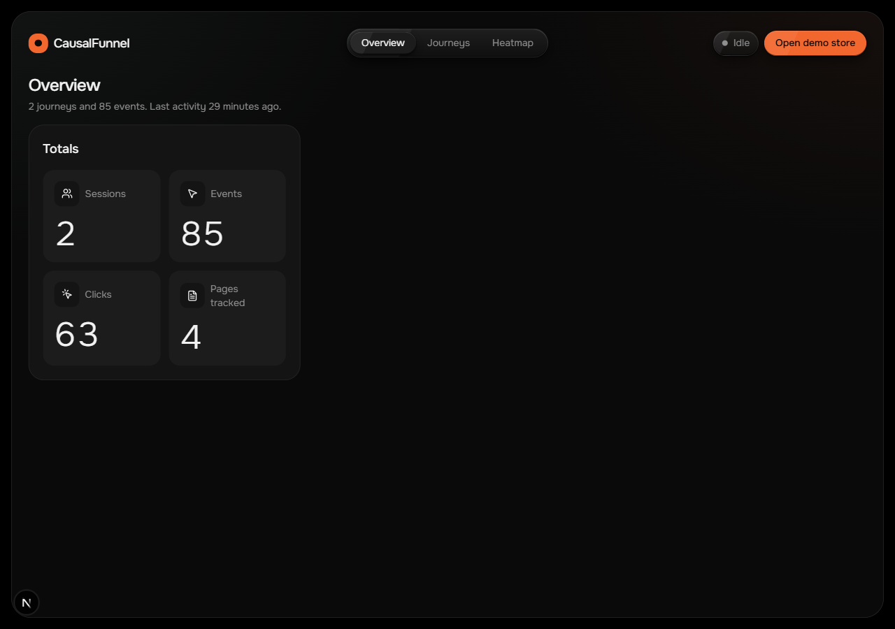
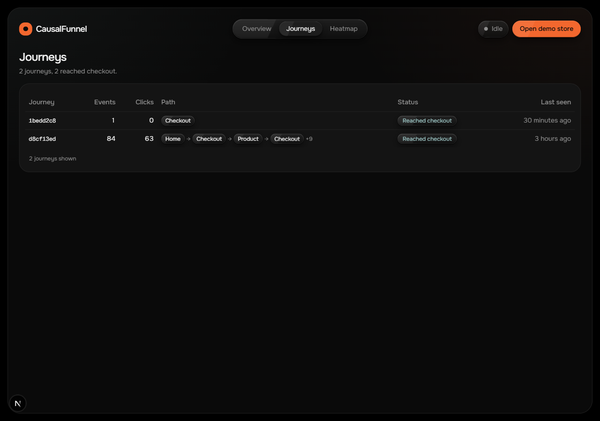
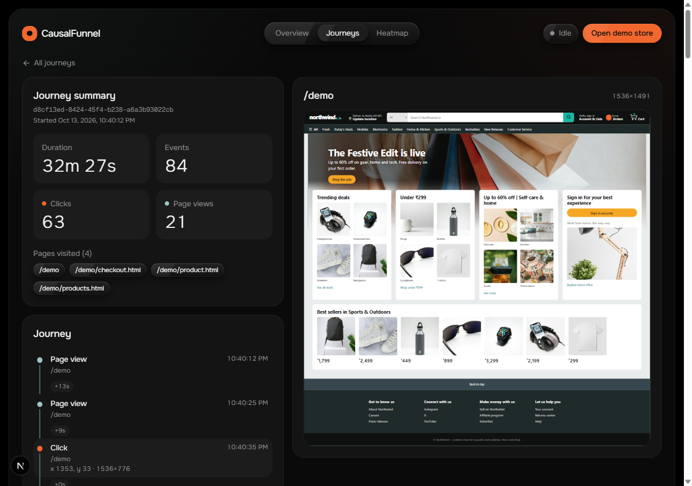
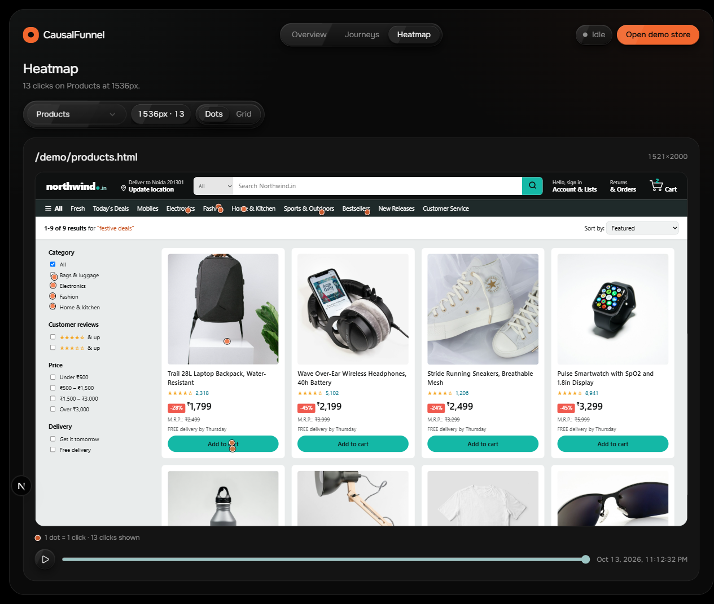
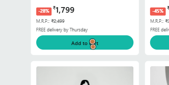
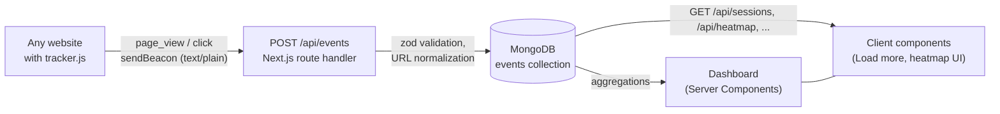

# CausalFunnel Analytics

A small user-analytics product built for the CausalFunnel Full Stack Engineer assignment. A plain JavaScript tracker records page views and clicks on any website and sends them to a Next.js API, which stores them in MongoDB. A dashboard then shows every visitor session as an ordered journey and draws click heatmaps on top of a live preview of each page, matched to the exact screen width the clicks were made at. A demo store is included, so you can generate real data in a few clicks.

- **Live demo:** `<add after deploy>`
- **Demo store:** `<add after deploy>/demo`

## Screenshots

**Overview:** totals and a one-line summary from the database.



**Journeys:** every session, its path through the store, and whether it reached checkout.



**Journey detail:** the timeline of one session; selecting a step previews that page with the click marked.



**Heatmap:** clicks for one page at one exact screen width, drawn on the page itself.



**Heatmap close-up:** two clicks on the first "Add to cart" button land on the button.



## How it works



1. The tracker keeps a session id in `localStorage` and sends a `page_view` on load (and on SPA navigation) and a `click` with coordinates and screen size on every click.
2. `POST /api/events` validates each event, normalizes `page_url` to origin + path, and inserts it.
3. Dashboard pages are Server Components that read from MongoDB through a small service layer. Sessions, paths, totals and heatmap groups are all computed with MongoDB aggregations.
4. Interactive parts (Load more, the heatmap controls and replay) run in the browser and call the public API.

## Tech stack

| Layer | Choice |
|---|---|
| Framework | Next.js 16 (App Router, Cache Components, Turbopack), React 19 |
| Language | TypeScript (strict) |
| Backend | Next.js Route Handlers on the Node.js runtime |
| Database | MongoDB Atlas with Mongoose 9 |
| Validation | zod 4 |
| UI | Tailwind CSS 4, shadcn/ui (Radix), lucide icons, sonner toasts |
| Fonts | Onest, Geist Mono (session ids only) |
| Animation | motion (nav pill), anime.js 4 (heatmap replay) |
| Tracker | Plain ES2017 JavaScript, no dependencies, about 4 KB |

## Setup

**Prerequisites:** Node.js 20.9 or newer, npm, and a MongoDB database (a free MongoDB Atlas cluster works).

```bash
git clone <repo-url>
cd causalfunnel
npm install
cp .env.example .env.local
```

Edit `.env.local`:

```bash
MONGODB_URI=mongodb+srv://<user>:<password>@<cluster>.mongodb.net/causalfunnel
ALLOWED_ORIGINS=*        # origins sent back in CORS headers (see note under "Embedding")
```

Then:

```bash
npm run dev
```

1. Open http://localhost:3000/demo and click around the store. Each click is sent to the API.
2. Open http://localhost:3000/dashboard to see the data. The Overview, Journeys and Heatmap pages read from the same events.

Other scripts:

| Command | What it does |
|---|---|
| `npm run smoke` | Runs 16 API checks against a running server (`npm run dev` first): validation errors, CORS, inserts, ordering, pagination, 404s, heatmap filtering. Its events use `https://smoke.example/...` URLs. |
| `npm run clean:test` | Dry run: lists test sessions (smoke test, `/__test/` URLs) and how many events they have. Deletes nothing. |
| `npm run clean:test -- --yes` | Deletes those test sessions. Real demo data is never matched. |
| `npm run build` | Production build. Note: it needs network access once to download the Onest font. |

## Embedding the tracker on any site

Add one script tag before `</body>`:

```html
<script
  src="https://<your-deployment>/tracker.js"
  data-endpoint="https://<your-deployment>/api/events"
  defer
></script>
```

- `data-endpoint` is optional. Without it, the tracker posts to `/api/events` on the same origin it was loaded from.
- Add `data-debug` to log every event and error with `console.debug`.
- `ALLOWED_ORIGINS` only controls the CORS response headers. It does **not** block events: the tracker sends `text/plain` and never needs to read the response, so events from any origin are stored. Enforcing an origin allowlist (or per-site keys) on ingestion is listed under "What I would do next".
- The tracker never throws on the host page; all errors are caught.
- `window.CausalFunnel.sessionId()` returns the current session id, for debugging.

## API reference

All responses use one envelope:

```jsonc
{ "data": ... }                                            // success
{ "error": { "code": "validation_error", "message": "x: Invalid input" } }  // failure
```

| Status | `code` | When |
|---|---|---|
| 400 | `validation_error` | Input fails the zod schema. The message is the first issue, prefixed with its field path. |
| 400 | `invalid_json` | The request body is not valid JSON. |
| 400 | `invalid_cursor` | The sessions `cursor` can't be decoded. |
| 404 | `not_found` | Unknown session id. |
| 405 | (Next.js default) | Method not supported on the route. |
| 413 | `payload_too_large` | Body over 64 KB. |
| 500 | `internal_error` | Anything unexpected. Logged on the server; the client gets a generic message. |

### `POST /api/events`

Records one event or a batch of up to 50. The body is read as text and parsed as JSON, so both `text/plain` (what the tracker sends) and `application/json` work.

```jsonc
// page_view
{ "session_id": "8c3e…", "event_type": "page_view", "page_url": "https://shop.example/products.html",
  "timestamp": "2026-10-13T17:42:30.000Z", "referrer": "https://google.com/" }

// click
{ "session_id": "8c3e…", "event_type": "click", "page_url": "https://shop.example/products.html",
  "timestamp": "2026-10-13T17:42:32.344Z", "x": 460, "y": 646,
  "viewport_w": 1536, "viewport_h": 776, "page_h": 2000, "layout_w": 1521 }
```

Rules:
- `session_id` must be a UUID.
- `page_url` must be http(s); it's stored as origin + path.
- `timestamp` is an ISO date or epoch milliseconds, at most 24h in the future.
- Clicks require non-negative `x`/`y` and positive `viewport_w`, `viewport_h` and `page_h`.
- `layout_w`, `referrer` and `user_agent` are optional.

Response `201`: `{ "data": { "inserted": 1 } }`

### `OPTIONS /api/events`

CORS preflight. Returns `204` with `Access-Control-Allow-Origin` (`*`, or the request origin if it is listed in `ALLOWED_ORIGINS`), `-Methods: POST, OPTIONS` and `-Headers: Content-Type`. The tracker normally doesn't trigger a preflight; see "sendBeacon" under Design decisions.

### `GET /api/sessions?limit=50&cursor=`

Sessions, newest activity first. `limit` is 1–100 (default 50). `cursor` is the `nextCursor` from the previous page.

```json
{
  "data": {
    "sessions": [
      {
        "session_id": "d8cf13ed-8424-45f4-b238-a6a3b93022cb",
        "event_count": 84, "click_count": 63, "page_view_count": 21,
        "first_seen": "2026-10-13T17:10:12.000Z", "last_seen": "2026-10-13T17:42:39.000Z",
        "pages": ["http://localhost:3000/demo", "http://localhost:3000/demo/products.html"],
        "reached_checkout": true,
        "path": ["http://localhost:3000/demo", "http://localhost:3000/demo/products.html", "http://localhost:3000/demo/checkout.html"]
      }
    ],
    "nextCursor": "eyJ0IjoiMjAyNi0xMC0xM1Qx…"
  }
}
```

`path` is the page-view sequence with consecutive repeats removed. `nextCursor` is `null` on the last page.

### `GET /api/sessions/{sessionId}/events`

All events of one session, ordered by `timestamp`. A malformed id returns `400`; an unknown id returns `404`.

```json
{ "data": [
  { "id": "6700…", "session_id": "d8cf13ed-…", "event_type": "page_view", "page_url": "http://localhost:3000/demo",
    "timestamp": "2026-10-13T17:10:12.000Z", "received_at": "2026-10-13T17:10:12.150Z" },
  { "id": "6701…", "session_id": "d8cf13ed-…", "event_type": "click", "page_url": "http://localhost:3000/demo",
    "timestamp": "2026-10-13T17:10:35.000Z", "received_at": "2026-10-13T17:10:35.120Z",
    "x": 1353, "y": 33, "viewport_w": 1536, "viewport_h": 776, "page_h": 1491 }
] }
```

### `GET /api/heatmap?page_url=`

Click points for one page, oldest first. `page_url` is required and is normalized the same way as on insert, so `?query` and `#hash` are ignored.

```json
{ "data": {
  "page_url": "http://localhost:3000/demo/products.html",
  "clicks": [ { "x": 460, "y": 646, "viewport_w": 1536, "page_h": 2000, "layout_w": 1521, "timestamp": "2026-10-13T17:42:32.344Z" } ]
} }
```

### `GET /api/pages`

Every tracked page with click and view counts, most viewed first.

```json
{ "data": [ { "page_url": "http://localhost:3000/demo/checkout.html", "clicks": 31, "views": 4 } ] }
```

## Data model and indexes

One collection, `events`:

```ts
{
  session_id: string,              // UUID from the tracker
  event_type: "page_view" | "click",
  page_url: string,                // origin + path, no query or hash
  timestamp: Date,                 // when it happened (visitor's clock)
  received_at: Date,               // when the API stored it
  // clicks only
  x, y: number,                    // pageX / pageY (document coordinates)
  viewport_w, viewport_h: number,  // window.innerWidth / innerHeight
  page_h: number,                  // document height
  layout_w?: number,               // documentElement.clientWidth (viewport minus scrollbar)
  // optional
  referrer?: string, user_agent?: string
}
```

| Index | Used by |
|---|---|
| `{ session_id: 1, timestamp: 1 }` | A session's journey: filter and sort in one index |
| `{ page_url: 1, event_type: 1 }` | Heatmap clicks for a page, page list |
| `{ timestamp: -1 }` | Newest event (Live/Idle), time-sorted aggregations |

**Why sessions are derived, not stored.** There's no `sessions` collection. Session totals, first and last seen, the page path and "reached checkout" are computed with a `$group` aggregation over events. Writes stay simple (one insert per event) and the two can never disagree. The cost is that the sessions list scans more data as events grow. At larger scale I'd keep a pre-aggregated `sessions` collection updated on insert.

## Design decisions and trade-offs

**Sessions.** A session is a random UUID stored in `localStorage` (`cf_session`) and renewed after 30 minutes without events. It identifies a browser tab history, not a person: a new device, browser or cleared storage starts a new session. If storage is blocked (private mode), the session lives in memory for that page. A persistent `visitor_id` and linking sessions to logged-in users are future work.

**sendBeacon with text/plain.** Events are sent with `navigator.sendBeacon`, falling back to `fetch` with `keepalive`, so clicks that navigate away are not lost. The body is `text/plain`, which is a "simple" request, so browsers don't send a CORS preflight. The API reads the body as text and parses it itself.

**Heatmaps per exact screen width.** A responsive page lays out differently at every window width, so a click's x/y only matches the layout at the width it was recorded at. The heatmap groups clicks by exact `viewport_w` (chips like "1536px · 13"), shows one width at a time, and renders the page at that width. The cost: a page visited at many widths splits into many small heatmaps, and there's no merged view.

**`layout_w` scrollbar fix.** `innerWidth` includes the vertical scrollbar (about 15px on Windows), but the page lays out in the width without it. The tracker also sends `layout_w = document.documentElement.clientWidth`, and the heatmap renders at that width. Clicks recorded before this field existed can be off by up to the scrollbar width. The viewer's fonts can still wrap text slightly differently from the visitor's.

**Sandboxed preview iframes.** `page_url` comes from public, unauthenticated input, so previews are sandboxed.
- The heatmap uses `sandbox="allow-same-origin"` with no scripts: the page lays out without running any of its JavaScript.
- The journey preview uses `allow-scripts` without `allow-same-origin`: scripts run in an isolated origin that can't reach the dashboard's cookies, storage or DOM.
- Both use no referrer and ignore pointer events.

**`?cf_preview=1`.** Preview iframes load pages with `cf_preview=1`, and the tracker stops completely when it sees it. Otherwise the dashboard would record its own previews as visits. Automated tests and screenshots of the demo store use it for the same reason.

**Tracker cache-busting.** Sites embed a stable `/tracker.js` URL, so it is served with `Cache-Control: public, max-age=300`. A tracker update reaches every visitor within 5 minutes, at the cost of browsers re-checking it more often. The demo pages load `/tracker.js?v=N`, bumped on every change, so they update immediately.

**Keyset pagination.** The sessions list pages on `(last_seen, session_id)` with an opaque base64url cursor instead of `skip`. Pages stay consistent while new events arrive, and paging doesn't get slower further down the list.

**Single collection and indexes.** Everything is one `events` collection with three indexes matched to the queries above. This keeps the write path to one insert and lets every view be a query or aggregation.

**Next.js route handlers as the Node backend.** The assignment asks for a Node.js backend. Route handlers run on the Node.js runtime, which gives one repo and one deploy. The backend code lives in `src/server/` and doesn't depend on React, so it could move to Express if needed.

**No auth, no rate limiting.** The dashboard and API are open, and the ingestion endpoint accepts any well-formed event from any origin (`ALLOWED_ORIGINS` only affects CORS response headers). Inputs are validated (schemas, a 64 KB body limit, at most 50 events per batch, sane timestamps), but anyone can send fake events. Authentication, per-site keys and rate limiting are the first things to add before real use.

**Adblockers.** Some content blockers block scripts named `tracker.js` or requests to `/api/events`. Those visitors are simply not counted. Serving the script and endpoint under neutral names on the customer's own domain would reduce this.

**Time zones.** Everything is stored and sent in UTC (ISO 8601). Times are shown in the viewer's local time zone: the server renders UTC with a "UTC" label and the browser switches to local time after loading. Relative times ("4m ago") are computed against the time the data was fetched, so server and browser output match.

## Project structure

```
public/
  tracker.js                 embeddable tracker (plain JS)
  demo/                      demo store: 4 pages, store.css, img/ (Unsplash, credited)
scripts/
  smoke-test.mjs             API smoke test (npm run smoke)
  clean-test-data.mjs        removes test sessions (npm run clean:test)
src/
  app/
    api/                     route handlers: events, sessions, heatmap, pages
    dashboard/               overview, journeys, journey detail, heatmap
  components/                UI: dashboard, sessions, heatmap, shadcn ui/
  lib/                       validation (zod), formatting, utils
  server/                    db connection, event model, services (aggregations), http helpers
  types/                     shared types
docs/                        PRD, architecture, design, rules, phases, memory, images
```

## What I would do next

- **Overview bento:** weekly activity bars, change vs the previous week, top pages, a heatmap preview, a clicks-by-hour grid. These are specified in `docs/DESIGN.md` and not built yet.
- **Identity:** a persistent `visitor_id` across sessions, and optional linking to logged-in users.
- **Security:** authentication for the dashboard, per-site keys or an enforced origin allowlist for ingestion, rate limiting.
- **Scale:** a pre-aggregated `sessions` collection updated on insert, and time-bucketed rollups for the dashboard.
- **Tests:** automated tests in CI (unit tests for the services, Playwright for the dashboard and the tracker).
- **Heatmap:** an optional view that merges nearby widths, plus scroll-depth tracking.
- **Remaining motion:** count-up numbers and bar animations, already specified in the design doc.
