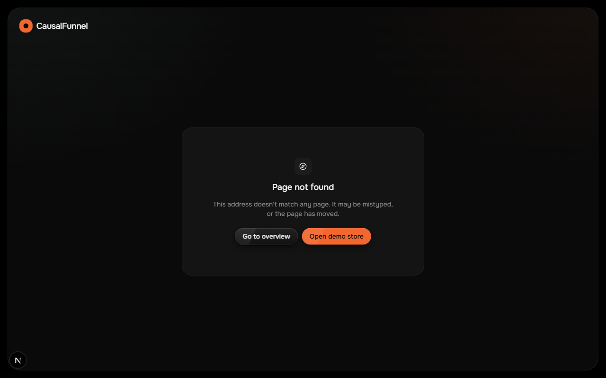
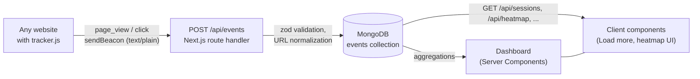

# CausalFunnel Analytics

A small user-analytics product built for the CausalFunnel Full Stack Engineer assignment. A plain JavaScript tracker records page views and clicks on any website and sends them to a Next.js API, which stores them in MongoDB. A dashboard shows traffic and conversion for the last 7, 14 or 28 days, lists every visitor session as an ordered journey, and draws click heatmaps on top of a live preview of each page at the exact screen width the clicks were made at. A demo store, "Northwind", is included so you can generate real data in a few clicks; optional seed data fills the dashboard with 150 demo journeys.

- **Live demo:** `LIVE_URL/dashboard`
- **Demo store:** `LIVE_URL/demo`

## Screenshots

**Overview:** KPIs with change vs the previous period, the Home → Checkout funnel, devices, daily activity, top clicked elements, clicks by day and hour, and recent journeys.


**Journeys:** every session, its path through the store, and whether it reached checkout.


**Journey detail:** the timeline of one session; selecting a step previews that page with the click marked.


**Heatmap:** clicks for one page at one exact screen width, drawn on the page itself.


**Heatmap close-up:** clicks on the first "Add to cart" button land on the button.


**404:** any unknown URL.



## How it works



1. The tracker keeps a session id in `localStorage`. It sends a `page_view` on load (and on single-page-app navigation) and a `click` with coordinates, screen size and a short description of the clicked element on every click.
2. `POST /api/events` validates each event, normalizes `page_url` to origin + path, and inserts it.
3. Dashboard pages are Server Components that read MongoDB through a small service layer. Sessions, paths, KPIs, the funnel and the heatmap groups are all computed with MongoDB aggregations.
4. Interactive parts (Load more, the heatmap controls and replay, chart tooltips) run in the browser; Load more and the heatmap page list call the public API.

## Features

**Overview** (`/dashboard`)
- Range selector: last 7, 14 or 28 days. Every number is compared with the previous period of the same length (cut at the same time of day).
- KPIs: journeys, conversion rate (journeys that reached `/checkout.html`), average journey duration, bounce rate (journeys with one page view) and clicks. Each has a change pill (green is good; for bounce rate a decrease is green) and a daily sparkline.
- Funnel Home → Products → Product → Checkout with counts, % of the first step and drop-off between steps. Each step opens that page's heatmap.
- Devices: desktop (≥ 768px) vs mobile, with conversion for each. Journeys without clicks are shown as "unknown", because page views carry no screen width.
- Daily activity (journeys as bars, events as a line), the 6 most clicked elements, clicks by weekday × 2-hour block, and the 6 most recent journeys.
- Days and hours use the viewer's time zone (see Design decisions).
- Each card has its own loading skeleton, empty state and error state with "Try again".

**Journeys** (`/dashboard/journeys`) and **journey detail** (`/dashboard/journeys/{id}`)
- Every session, newest activity first, with event and click counts, the page path, "Reached checkout" or "Browsing", and last seen. Load more uses keyset pagination.
- The detail page shows duration, events, clicks, page views, the pages visited, a copy button for the session id, and the full timeline. Selecting a step shows that page in a preview with the click marked.

**Heatmap** (`/dashboard/heatmap?page=…&w=…`)
- One page at one exact screen width at a time, chosen from chips like "1536px · 231".
- The page is rendered at that width in a sandboxed iframe, scaled to fit, with clicks drawn on top.
- Dots (one per click) or Grid (density cells with a legend).
- Replay: a scrubber that plays the clicks back in time order (reduced motion jumps to the end).

**Tracker** (`public/tracker.js`)
- Plain ES2017, no dependencies, about 7 KB unminified. It never throws on the host page.
- Sessions renew after 30 minutes without events. SPA navigation (`pushState`, `replaceState`, `popstate`) records a page view only when the path changes.

**Demo store** (`/demo`)
- Four static pages (home, product list, product, checkout) with an Amazon-style layout under its own brand. Photos are from Unsplash and Pexels, credited in `public/demo/img/CREDITS.md`.

## Tech stack

| Layer | Choice |
|---|---|
| Framework | Next.js 16 (App Router, Cache Components, Turbopack), React 19 |
| Language | TypeScript (strict) |
| Backend | Next.js route handlers on the Node.js runtime |
| Database | MongoDB Atlas with Mongoose 9 |
| Validation | zod 4 |
| UI | Tailwind CSS 4, shadcn/ui (Radix), lucide icons, sonner toasts |
| Charts | Recharts 3 through shadcn `chart` (sparklines and the activity chart only) |
| Fonts | Onest, Geist Mono (session ids only) |
| Animation | motion (nav pill), anime.js 4 (heatmap replay) |
| Tracker | Plain ES2017 JavaScript, no dependencies |

## Setup

**Prerequisites:** Node.js 22.6 or newer (the seed script uses Node's built-in TypeScript stripping), npm, and a MongoDB database (a free MongoDB Atlas cluster works).

```bash
git clone <repo-url>
cd causalfunnel
npm install
cp .env.example .env.local
```

Edit `.env.local`:

```bash
MONGODB_URI=mongodb+srv://<user>:<password>@<cluster>.mongodb.net/causalfunnel
ALLOWED_ORIGINS=*        # origins sent back in CORS headers (see "Embedding the tracker")
```

Then:

```bash
npm run dev
npm run seed             # optional: 150 demo journeys over the last 28 days
```

1. Open http://localhost:3000/demo and click around the store. Each click is sent to the API.
2. Open http://localhost:3000/dashboard. Overview, Journeys and Heatmap all read the same events.

Seeded events are marked `source: "seed"` and the dashboard shows an "Includes demo data" pill while any exist. Re-running `npm run seed` replaces the old seed data; real events are never touched.

Other scripts:

| Command | What it does |
|---|---|
| `npm run seed -- --clear` | Removes seed data only. |
| `npm run seed -- --origin https://app.example` | Seeds with page URLs on another origin, so the heatmap preview loads the deployed demo pages. |
| `npm run seed:prod -- --origin https://app.example` | Same as `seed`, but reads `.env.production.local` (gitignored) instead of `.env.local`, for seeding the deployed database. It refuses to run without `--origin`. `--clear` works here too. |
| `npm run smoke` | Runs 16 API checks against a running server (`npm run dev` first): validation errors, CORS, inserts, ordering, pagination, 404s, heatmap filtering. Its events use `https://smoke.example/...` URLs. |
| `npm run clean:test` | Dry run: lists test sessions (smoke test and `/__test/` URLs) and how many events they have. Deletes nothing. |
| `npm run clean:test -- --yes` | Deletes those test sessions. Demo store and seed data are never matched. |
| `npm run build` | Production build. It needs network access once to download the Onest font. |

## Embedding the tracker on any site

Add one script tag before `</body>`:

```html
<script
  src="https://LIVE_URL/tracker.js"
  data-endpoint="https://LIVE_URL/api/events"
  defer
></script>
```

- `data-endpoint` is optional. Without it, the tracker posts to `/api/events` on the origin it was loaded from.
- `data-debug` logs every event and error with `console.debug`.
- `/tracker.js` is served with `Cache-Control: public, max-age=300`, so tracker updates reach visitors within 5 minutes. To pick up a change immediately, add a version: `/tracker.js?v=4`. The demo pages do this and bump the number on every tracker change.
- The tracker does nothing on pages opened with `?cf_preview=1` (the dashboard's own previews).
- `ALLOWED_ORIGINS` only controls the CORS response headers. It does not block events: the tracker sends `text/plain` and never reads the response, so events from any origin are stored.
- `window.CausalFunnel.sessionId()` returns the current session id, for debugging.

## API reference

All responses use one envelope:

```jsonc
{ "data": ... }                                                            // success
{ "error": { "code": "validation_error", "message": "x: Invalid input" } } // failure
```

| Status | `code` | When |
|---|---|---|
| 400 | `validation_error` | Input fails the zod schema. The message is the first issue, prefixed with its field path. |
| 400 | `invalid_json` | The request body is not valid JSON. |
| 400 | `invalid_cursor` | The sessions `cursor` can't be decoded. |
| 404 | `not_found` | Unknown session id. |
| 405 | (Next.js default) | Method not supported on the route. |
| 413 | `payload_too_large` | Body over 64 KB. |
| 500 | `internal_error` | Anything unexpected. Logged on the server; the client gets a generic message. |

### `POST /api/events`

Records one event or a batch of up to 50 (a JSON array). The body is read as text and parsed as JSON, so both `text/plain` (what the tracker sends) and `application/json` work.

```jsonc
// page_view
{ "session_id": "8c3e…", "event_type": "page_view", "page_url": "https://shop.example/products.html",
  "timestamp": "2026-10-13T17:42:30.000Z", "referrer": "https://google.com/" }

// click
{ "session_id": "8c3e…", "event_type": "click", "page_url": "https://shop.example/products.html",
  "timestamp": "2026-10-13T17:42:32.344Z", "x": 460, "y": 646,
  "viewport_w": 1536, "viewport_h": 776, "page_h": 2000, "layout_w": 1521,
  "target": "button.btn \"Add to cart\"" }
```

| Field | Rules |
|---|---|
| `session_id` | UUID |
| `event_type` | `page_view` or `click` |
| `page_url` | http(s) URL; stored as origin + path (no query, no hash, no trailing slash) |
| `timestamp` | ISO date with offset, or epoch milliseconds; at most 24h in the future |
| `referrer`, `user_agent` | Optional strings (max 2048 / 512 chars) |
| `x`, `y` | Clicks only. Document coordinates (`pageX`, `pageY`), ≥ 0 |
| `viewport_w`, `viewport_h`, `page_h` | Clicks only. Positive integers: `innerWidth`, `innerHeight`, document height |
| `layout_w` | Clicks, optional. `documentElement.clientWidth` (window width minus the scrollbar) |
| `target` | Clicks, optional, max 140 chars. Description of the clicked element (see "Click target privacy") |

Response `201`: `{ "data": { "inserted": 1 } }`

### `OPTIONS /api/events`

CORS preflight. Returns `204` with `Access-Control-Allow-Origin` (`*`, or the request origin if it is listed in `ALLOWED_ORIGINS`), `Access-Control-Allow-Methods: POST, OPTIONS` and `Access-Control-Allow-Headers: Content-Type`. The tracker normally doesn't trigger a preflight.

### `GET /api/sessions?limit=50&cursor=`

Sessions, newest activity first. `limit` is 1–100 (default 50). `cursor` is the `nextCursor` from the previous page.

```json
{
  "data": {
    "sessions": [
      {
        "session_id": "d8cf13ed-8424-45f4-b238-a6a3b93022cb",
        "event_count": 84, "click_count": 63, "page_view_count": 21,
        "first_seen": "2026-10-13T17:10:12.000Z", "last_seen": "2026-10-13T17:42:39.000Z",
        "pages": ["http://localhost:3000/demo", "http://localhost:3000/demo/products.html"],
        "reached_checkout": true,
        "path": ["http://localhost:3000/demo", "http://localhost:3000/demo/products.html", "http://localhost:3000/demo/checkout.html"]
      }
    ],
    "nextCursor": "eyJ0IjoiMjAyNi0xMC0xM1Qx…"
  }
}
```

`path` is the page-view sequence with consecutive repeats removed. `nextCursor` is `null` on the last page.

### `GET /api/sessions/{sessionId}/events`

All events of one session, ordered by `timestamp`. A malformed id returns `400`; an unknown id returns `404`. Click events include `target`; `layout_w` is not part of this response (the heatmap endpoint has it).

```json
{ "data": [
  { "id": "6700…", "session_id": "d8cf13ed-…", "event_type": "page_view", "page_url": "http://localhost:3000/demo",
    "timestamp": "2026-10-13T17:10:12.000Z", "received_at": "2026-10-13T17:10:12.150Z" },
  { "id": "6701…", "session_id": "d8cf13ed-…", "event_type": "click", "page_url": "http://localhost:3000/demo",
    "timestamp": "2026-10-13T17:10:35.000Z", "received_at": "2026-10-13T17:10:35.120Z",
    "x": 1353, "y": 33, "viewport_w": 1536, "viewport_h": 776, "page_h": 1491,
    "target": "Search box: Search Northwind" }
] }
```

### `GET /api/heatmap?page_url=`

Click points for one page, oldest first. `page_url` is required and is normalized the same way as on insert, so `?query` and `#hash` are ignored. `layout_w` and `target` are included when the click has them.

```json
{ "data": {
  "page_url": "http://localhost:3000/demo/products.html",
  "clicks": [
    { "x": 460, "y": 646, "viewport_w": 1536, "page_h": 2000, "layout_w": 1521,
      "target": "Checkbox: Bags & luggage", "timestamp": "2026-10-13T17:42:32.344Z" }
  ]
} }
```

### `GET /api/pages`

Every tracked page with click and view counts, most viewed first.

```json
{ "data": [ { "page_url": "http://localhost:3000/demo/checkout.html", "clicks": 31, "views": 4 } ] }
```

## Data model and indexes

One collection, `events`:

```ts
{
  session_id: string,              // UUID from the tracker
  event_type: "page_view" | "click",
  page_url: string,                // origin + path, no query or hash
  timestamp: Date,                 // when it happened (visitor's clock)
  received_at: Date,               // when the API stored it
  referrer?: string, user_agent?: string,
  // clicks only
  x, y: number,                    // pageX / pageY (document coordinates)
  viewport_w, viewport_h: number,  // window.innerWidth / innerHeight
  page_h: number,                  // document height
  layout_w?: number,               // documentElement.clientWidth (viewport minus scrollbar)
  target?: string,                 // description of the clicked element
  // set only by scripts/seed.ts, never accepted from the API
  source?: "seed"
}
```

| Index | Used by |
|---|---|
| `{ session_id: 1, timestamp: 1 }` | A session's journey: filter and sort in one index |
| `{ page_url: 1, event_type: 1 }` | Heatmap clicks for a page, the page list |
| `{ timestamp: -1 }` | Newest event (Live/Idle), period windows for the Overview |
| `{ source: 1 }` (sparse) | "Includes demo data" check and removing seed data |

**Why sessions are derived, not stored.** There's no `sessions` collection. Session totals, first and last seen, the page path, "reached checkout", and every Overview metric are computed with aggregations over events (`$group` by `session_id`, then `$facet` for the period comparisons). Writes stay one insert per event, and a session can never disagree with its events. The cost is that these queries scan more data as events grow; at larger scale I'd keep a pre-aggregated `sessions` collection updated on insert.

## Design decisions and trade-offs

**Sessions, not visitors.** A session is a random UUID in `localStorage`, renewed after 30 minutes without events. It identifies one browser, not a person: another device, browser or cleared storage starts a new session, and if storage is blocked the session lives in memory for that page. A persistent `visitor_id` and linking to logged-in users are future work.

**sendBeacon with text/plain.** Events go out with `navigator.sendBeacon` (falling back to `fetch` with `keepalive`), so a click that navigates away is not lost. A `text/plain` body is a "simple" request, so browsers skip the CORS preflight; the API reads the body as text and parses it itself.

**Heatmaps per exact screen width.** A responsive page lays out differently at every width, so a click's x/y only matches the layout it was recorded on. The heatmap groups clicks by exact `viewport_w` and renders the page at that width. The cost is that a page visited at many widths splits into many small heatmaps, with no merged view.

**`layout_w` scrollbar fix.** `innerWidth` includes the vertical scrollbar (about 15px on Windows), but the page lays out without it. The tracker also sends `layout_w` (`clientWidth`), and the preview renders at that width; older clicks without it can be off by up to the scrollbar width.

**Sandboxed preview iframes.** `page_url` comes from public, unauthenticated input. The heatmap preview uses `sandbox="allow-same-origin"` with no scripts, so the page lays out without running its JavaScript. The journey preview allows scripts but not same-origin, so they can't reach the dashboard's cookies, storage or DOM.

**`?cf_preview=1`.** Preview iframes load pages with `cf_preview=1`, and the tracker stops completely when it sees it. Otherwise the dashboard would record its own previews as visits. Automated tests and screenshots of the demo store use it for the same reason.

**Tracker cache-busting.** Customer sites embed a stable `/tracker.js` URL, so it is cached for only 5 minutes. The demo pages load `/tracker.js?v=N`, bumped on every change, so they update immediately.

**Click target privacy.** `target` is built only from static page text, never from what a visitor typed or selected. Form fields are described as "Kind: name" (for example "Search box: Search Northwind", "Checkbox: Bags & luggage"), where the name is the field's label, else its `aria-label`, else its placeholder, else `tag#id`. Other elements send their tag, id or first class, and up to 60 characters of visible text.

**Seed data isolation.** Seeded events carry `source: "seed"`. The API schema doesn't accept that field, so tracker traffic can't fake or delete seed data, and `npm run seed -- --clear` only ever removes seeded events. Seed clicks use element positions captured from the real demo pages, so they land on the element their `target` names.

**Keyset pagination.** The sessions list pages on `(last_seen, session_id)` with an opaque cursor instead of `skip`. Pages stay consistent while new events arrive, and later pages are no slower than the first.

**Next.js route handlers as the Node backend.** The assignment asks for a Node.js backend. Route handlers run on the Node.js runtime, which gives one repo and one deploy. The backend code in `src/server/` doesn't depend on React, so it could move to Express if needed.

**No auth, no rate limiting.** The dashboard and API are open, and ingestion accepts any well-formed event from any origin. Inputs are validated (schema, 64 KB body limit, at most 50 events per batch, no timestamps more than 24h ahead), but anyone can send fake events.

**Adblockers.** Some content blockers block scripts named `tracker.js` or requests to `/api/events`; those visitors are not counted. Serving the script and endpoint under neutral names on the customer's own domain would reduce this.

**Time zones.** Everything is stored and sent in UTC. The browser writes its IANA time zone to a `cf_tz` cookie, and the Overview groups days and hours in that zone (falling back to UTC, labelled, until the cookie exists). Timestamps elsewhere render as UTC on the server and switch to local time in the browser.

## Project structure

```
public/
  tracker.js                 embeddable tracker (plain JS)
  demo/                      demo store: 4 pages, store.css, img/ (credited)
scripts/
  seed.ts                    demo seed data (npm run seed, seed:prod)
  seed-layout.json           element positions captured from the demo pages
  capture-seed-layout.js     Playwright snippet that captures them
  smoke-test.mjs             API smoke test (npm run smoke)
  clean-test-data.mjs        removes test sessions (npm run clean:test)
src/
  app/
    api/                     route handlers: events, sessions, heatmap, pages
    dashboard/               overview, journeys, journey detail, heatmap
    not-found.tsx            global 404
  components/                dashboard, overview, sessions, heatmap, shadcn ui/
  lib/                       validation (zod), formatting, utils
  server/                    db connection, event model, services (aggregations), http helpers
  types/                     shared types
docs/                        PRD, architecture, design, rules, phases, memory, images
```

## What I would do next

- **Journey timeline:** group events into page visits (one row per page with its clicks inside). The detail page of a long session is very long today.
- **Visitors:** a persistent `visitor_id` across sessions, and optional linking to logged-in users.
- **Auth:** log-in for the dashboard, and per-site keys or an enforced origin allowlist for ingestion.
- **Rate limiting:** per IP and per site on `POST /api/events`.
- **Batching in the tracker:** queue events and send them in batches (the API already accepts up to 50 per request), flushing on page hide.
